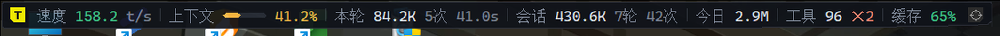
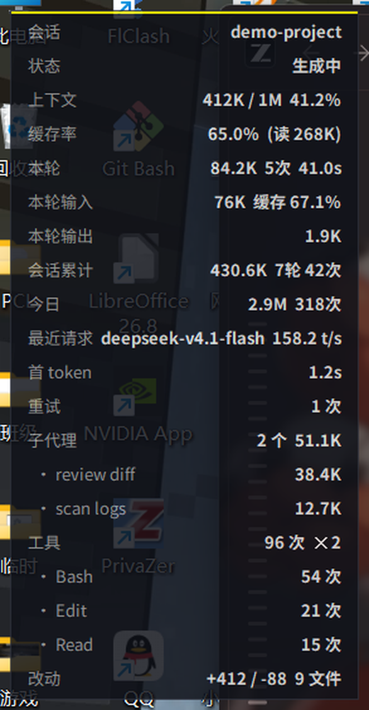
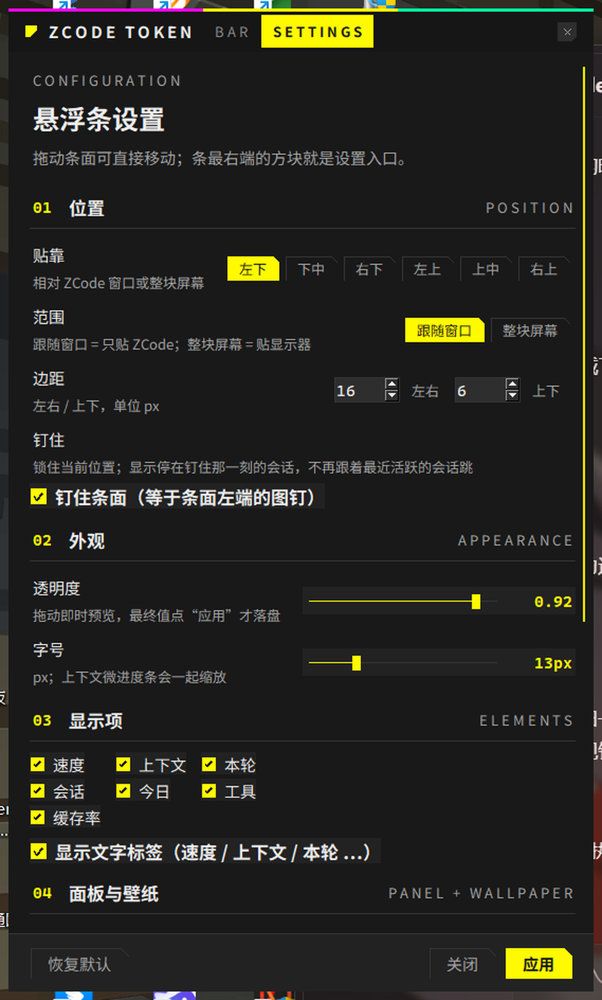

# ZCode Token 悬浮条

给 [ZCode](https://zcode.ai) 桌面客户端用的 token 用量悬浮条：**独立进程**，不碰客户端安装目录。

左端图钉钉住当前会话与位置，右端方块打开设置面板 ▼



> 截图用的是演示数据，不是任何真实会话。

左端图钉点一下 = **钉住**：显示停在当前会话（不再跟着「最近活跃」的会话跳，
别的窗口在跑也照旧），位置同时锁死——拖不动、不随窗口贴靠重算。再点一下解除；
钉住的会话在本地库和远端都查不到时自动解钉，回到跟随模式。右键菜单和设置面板
「01 位置」里是同一个开关。

> 这是从 [zcode-token-usage-statusbar](https://github.com/xhwxt/zcode-token-usage-statusbar)
> 派生的**独立项目**，只保留「悬浮条」这一条路线并重写。上游的状态条走 asar 注入，
> 本项目走的是另一条路（见下）。原作者的 MIT 署名保留在 [LICENSE](LICENSE)。

---

## 为什么不用注入版

上游的做法是往 `resources/app.asar` 里注入一行 loader。官方每次升级都整包替换
`app.asar`，注入行随之消失——表现为「状态条不见了」，而且重装必须先完全退出客户端
（文件被占用，`WinError 5`）。

这个项目不这么干：

| | 注入版 | 本项目 |
|---|---|---|
| 改客户端文件 | 是（`app.asar`，341 MB） | **否** |
| 官方升级后 | 要重跑一次注入 | **不受影响** |
| 安装前要先退出 ZCode | 是 | **否** |
| 画在哪 | 嵌在对话窗口底部 | 浮在窗口上（可贴边） |
| 依赖 | Electron 内部机制 | 无，只读 SQLite |

代价是它浮在窗口上而不是嵌在底部。默认靠 Windows 的**属主窗口绑定**让它只压在 ZCode
之上——随 ZCode 最小化一起让路、不抢焦点、不占任务栏——所以代价比听起来小。

### 相比原版多了什么

| 能力 | 原版注入状态条 | 本项目悬浮条 |
|---|---|---|
| 安装 / 升级 | 改 `app.asar`，官方升级后要重注入 | 解压即用，官方升级不影响 |
| 缓存率 | 无 | 条面直接显示命中率（cache_read ÷ input） |
| 悬停详情 | 无 | 会话、上下文、本轮输入输出、工具 Top3、子代理、改动行数 |
| 设置入口 | 改客户端源码 | 条面右端切角方块，独立设置面板 |
| 面板外观 | 跟随客户端 | 无边框暗色自绘，可半透明（0.55–1.00） |
| 壁纸 | 只能在插件里调 | 面板内直接换图/压暗/模糊，**改完自动重注入，不用重启** |
| 位置 | 固定在底栏 | 六向贴靠 + 自由拖动，可跟随窗口或贴屏幕 |
| 钉住 | 无 | 一键锁定当前会话与条面位置，多窗口互不打架 |
| 服务器会话 | 只读本地库 | 同一份脚本两端各放一半，远端会话同样出缓存率与全部详情 |

---

## 装

只有一个前提：**Python 3.8+**。零第三方依赖，不需要 pip。

```bash
git clone https://github.com/suiren0219/zcode-token-bar.git
cd zcode-token-bar
python hoverbar.py
```

条面出现在 ZCode 窗口上。左端**图钉**钉住当前会话与位置，点最右端的**切角方块**打开设置面板。

```bash
python hoverbar.py              # 启动（已在运行则打开设置面板）
python hoverbar.py --settings   # 打开设置面板
python hoverbar.py --quit       # 关掉
python hoverbar.py --once       # 不开窗，只在终端打一次数据（排查用）
python hoverbar.py --debug      # 开窗并打印定位/取数过程
```

单实例：重复启动只会把设置面板叫到前面，不会再开第二条。

### 开机自启

```bash
python autostart.py on      # 写入 HKCU 的 Run 项
python autostart.py off     # 移除
python autostart.py status  # 看当前状态
```

只写当前用户，不需要管理员权限。

---

## 条面各项

| 项 | 显示内容 |
|---|---|
| 速度 | 最近一次完成请求的输出 tokens ÷ 生成耗时；≥70 绿、40–70 黄、<40 红 |
| 上下文 | 微进度条 + 占比，颜色随占比变化（大窗口 40%/60% 预警，其余 70%/85%） |
| 本轮 | 本轮 tokens（tokens 数） |
| 会话 | 当前会话累计 tokens |
| 今日 | 今天所有会话的 tokens |
| 工具 | 当前会话工具调用次数，错误时右侧标红 |
| 缓存率 | 命中缓存的输入 token ÷ 全部输入 token；≥60% 绿、30–60% 黄、<30% 灰 |

七项都能单独开关。关掉「显示文字标签」只留数字，条面会明显变短。

缓存率的分母是 `input_tokens` 本身——provider 口径里它已经包含
`cache_read_input_tokens`，所以命中率 = cache_read ÷ input。两者相加当分母
会正好算小一半。

### 悬停看详情

鼠标停在条面上约 0.45 秒，下方弹出详情浮层：会话名、状态、上下文占用、缓存率、
本轮输入/输出与缓存、会话累计、今日、最近请求的模型与 t/s、首 token、重试次数、
工具明细（Top 3）、改动行数，远端会话还会标出数据源。空字段直接略过，浮层在
条面下方放不下时自动翻到上方。



数据来自本地 SQLite（`~/.zcode/cli/db/db.sqlite`）的**只读**查询，全程不联网。
请求完成后才落库，所以数字反映的是「最近一次已完成请求」。

---

## 设置面板

终末地（endfield-ui）风格：acid yellow `#FFFA00` 是唯一强调色、只做填充、只表示
「当前 / 可点 / 注意」；切角 = 可点；展示容器一律直角；1px 细线分区；无阴影无发光无渐变。

**01 位置** — 贴靠（六选一）、范围（跟随窗口 / 整块屏幕）、边距（左右 / 上下 px）、
钉住（锁住当前位置，显示停在钉住那一刻的会话；与条面左端图钉同状态。钉住时改
贴靠/范围/边距，应用会按新锚点重新钉）

**02 外观** — 透明度 0.30–1.00、字号 10–22 px。拖动即时预览，点「应用」才落盘。

**03 显示项** — 七项开关 + 文字标签总开关

**04 面板与壁纸** — 面板自身透明度 0.55–1.00（半透明透出壁纸）、显示壁纸开关、
壁纸压暗 0–100、壁纸模糊 0–40 px、换壁纸（文件选择框，选完立刻生效）。

这一节读写 zcode-beautify 插件的同一份配置，不另存副本——在这里改和在 ZCode
客户端里改完全等价，两边不会打架。改完自动调插件自带的 CLI 重注入主题，
不用重启 ZCode；调不通时弹窗说清楚「已保存但未能立刻生效」，不假装成功。
插件没装时整节只剩一行提示。



**05 行为** — 总是置顶、ZCode 不在前台时隐藏

拖动条面本身是移动位置。指针按在两端方块（左图钉 / 右齿轮）上时会被识别成按钮，
不会把条拖走；钉住时条面整体不可拖。

面板没有系统标题栏：顶部是自绘的深色命令栏（三色斜条 + `ZCODE TOKEN / BAR /
SETTINGS` + 切角关闭按钮），拖它可以移动面板。内容比屏幕高时右侧出 3px 酸黄
滚动指示线，滚轮在标签、滑块、勾选框上也生效。面板按指针摆放并夹在屏幕内
（125% 缩放下原先会掉出底边，已修）。

---

## 为什么默认只浮在 ZCode 上

默认**不勾**「总是置顶」，靠的是 Windows 属主窗口绑定：
`SetWindowLongPtrW(条窗口, GWLP_HWNDPARENT, ZCode 主窗口)`。效果是

- 条面始终压在 ZCode 之上，不会被对话区盖住
- ZCode 最小化时条面一起收走，不会孤零零留在桌面上
- 不抢焦点，点条面不会把输入框踢掉
- 任务栏上没有它的条目

这比 `-topmost` 温和得多：切到浏览器看文档时它不会挡在那儿。找不到 ZCode 窗口时
条面会隐藏而不是乱飘，ZCode 启动后下一次轮询自动接上。

---

## 文件

| 文件 | 作用 |
|---|---|
| `hoverbar.py` | 悬浮条本体：无边框圆角胶囊 + 设置面板。Win32 属主绑定、DPI 感知、单实例 |
| `zusage.py` | 数据层：只读 SQLite 查询、上下文窗口查表、`serve` 行协议、`json` 子命令 |
| `autostart.py` | 开机自启管理（HKCU Run 项） |
| `hoverbar.json` | 运行期配置，首次运行自动生成，不入库 |
| `docs/USAGE.md` | 逐项说明、机制细节、排查 |

---

## 排查

**条面不出现**

```bash
python hoverbar.py --once     # 数据能不能取到
python hoverbar.py --debug    # 看定位与取数过程
```

`--once` 有输出说明数据链路正常，问题在窗口层——多半是找不到 ZCode 窗口（客户端没开）。

**数字全是 0**

- 请求完成才落库，正在生成的不计入
- 新会话还没产生已完成请求时是零值
- SSH 远程会话的数据落在**远端机**，本地库查不到。条面会显示「不在本地库」徽标，
  需要在 `zusage.py` 旁的 `config.json` 里配 `remote` 段（见 [docs/USAGE.md §5](docs/USAGE.md#5-取数链路)）

**上下文窗口显示成兜底值**

模型目录在 `~/.zcode/v2/runtime/provider/<平台>/<版本>/endpoint-*/zcode-builtin.json`。
`zusage.py` 按模型名正则匹配 `modelConfigRules.modelRules[].config.properties.contextWindow`，
找不到才退到内置表。ZCode 改了目录结构时这里是第一个要跟的地方。

---

## 已知限制

- **只支持 Windows**。属主窗口绑定和 DPI 处理都是 Win32 API（`user32` / `shcore`）。
  Linux/macOS 需要换一套窗口绑定方式。
- **浮在窗口上而不是嵌在底部**。这是不走注入的必然代价。
- **只测过单显示器**。多屏缩放不一致时贴靠坐标可能偏，用「整块屏幕」+ 拖动兜住。

---

## License

MIT，见 [LICENSE](LICENSE)。派生自
[zcode-token-usage-statusbar](https://github.com/xhwxt/zcode-token-usage-statusbar)（Copyright (c) 2026 xhwx）。
